<!-- Every card is an animated SVG drawn by scripts/render_cards.py from scripts/config.py and
     data/profile.json, and refreshed daily by .github/workflows/update-cards.yml.
     Spacing is baked into the SVGs: keep this block free of blank lines, and keep each
     three-card row on one line with no spaces between the links. -->

 
 
 
 
 

<a href="https://wasifsaeed.com">wasifsaeed.com</a> &nbsp;/&nbsp; <a href="https://www.linkedin.com/in/wasif-s">linkedin</a> &nbsp;/&nbsp; <a href="https://medium.com/@wasifsaeed0410">medium</a> &nbsp;/&nbsp; <a href="mailto:Wasifsaeed0410@gmail.com">email</a>

